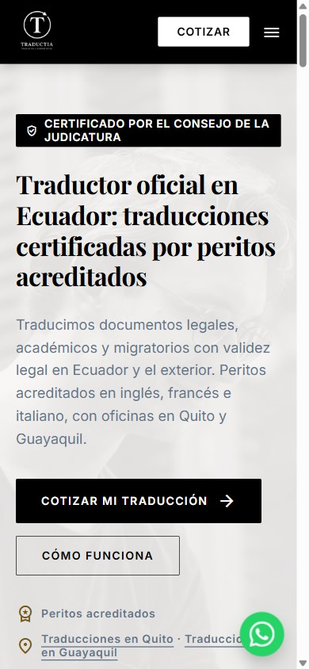

    

  
  &nbsp;
  

## Qué es

Traductia hace traducciones oficiales y certificadas en Quito y Guayaquil. Muchos de sus clientes son estadounidenses que se mudan a Ecuador y necesitan traducir antecedentes del FBI, apostillas o documentos para la visa.

## Qué se hizo

- **Tema de WordPress a medida con Tailwind CSS**, en español e inglés.
- **Páginas por ciudad y por servicio**: Guayaquil, Quito, apostillas, títulos Senescyt, antecedentes del FBI y visas.
- **Contacto rápido por WhatsApp** en cada página, con medición de cada clic.
- **SEO local y schema JSON-LD**, preguntas frecuentes y páginas pensadas para quien busca desde EE. UU.

## Resultados

- **+47 % de visitas desde Google** en 13 días (27 oct – 8 nov 2026 frente a los 13 días anteriores).
- **≈45 clics a WhatsApp en octubre**, contra 16 en septiembre.
- Top 2 en Google para «traducciones guayaquil».

---

Hecho por <a href="https://prismadevelop.com/">Prisma Develop</a> · El código es privado: este repo solo muestra el trabajo.

